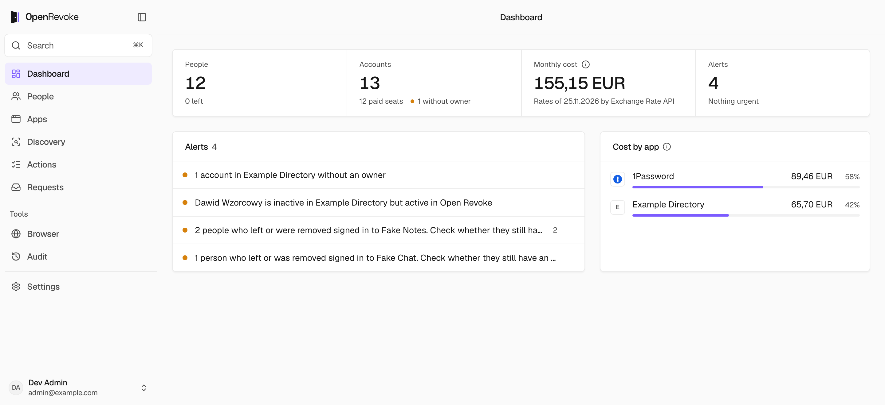

<h1 align="center">
  <a href="https://openrevoke.com">
    <picture>
      <source media="(prefers-color-scheme: dark)" srcset="docs/assets/logo-dark.svg">
      
    </picture>
  </a>
</h1>

<h3 align="center">Who has an account where, what it costs, and offboarding that removes it.</h3>

<p align="center">
  Self-hosted SaaS access management. Offboarding removes a leaver's accounts through the app's
  API, SCIM, or a logged-in browser session for apps without an API.
</p>

<p align="center">
  <a href="https://openrevoke.com">Website</a> ·
  <a href="https://openrevoke.com/docs">Docs</a> ·
  <a href="docs/connectors/README.md">Connectors</a> ·
  <a href="docs/self-hosting.md">Self-hosting</a> ·
  <a href="https://openrevoke.com/implementation">Implementation and support</a> ·
  <a href="CONTRIBUTING.md">Contributing</a>
</p>

<p align="center">
  <a href="https://www.bestpractices.dev/projects/17143"></a>
  <a href="https://slsa.dev"></a>
</p>

<p align="center">
  <a href="LICENSE"></a>
  
  
</p>

<p align="center">
  
</p>

## What is Open Revoke

A panel you run on your own server, for companies that use dozens of SaaS tools and have no single
place that shows people, costs and access.

- **Inventory.** One list of people and the accounts each person has in each app, synced from
  Google Workspace, GitHub, SCIM, Slack and others, matched by e-mail.
- **Costs.** Price per seat or per plan, converted to your currency with daily exchange rates.
- **Onboarding and offboarding.** Add or remove a person's accounts in every app in one step.
- **App discovery.** A scan of Google Workspace sign-ins shows third-party apps people use with the
  company account, including apps still used by people who left.
- **AI assistants.** A built-in MCP server lets Claude Code, Codex or Cursor do what you can do in
  the panel.

## How it works

Open Revoke talks to each app in one of three ways:

1. **Official API**, for example the Google Admin SDK or the GitHub REST API.
2. **SCIM 2.0**, one generic connector for any app with a SCIM endpoint.
3. **A logged-in browser session**, for apps without an API. Chromium runs in Docker, an admin logs
   in once through a live view in the panel (Open Revoke never sees the password), and the
   connector sends the same requests the app's admin panel sends.

Apps without a connector are kept by hand: offboarding creates a checklist task instead of a write.

Every write (an invitation, a removal) waits for a person to approve it, runs in the background and
is then checked by reading the app's account list again. A write the read does not confirm ends as
failed, even if the app answered 200. A sync that would remove more than 30% of an app's accounts
stops and changes nothing.

## Status

Early MVP. Read this before you connect real apps.

- Most connectors are not verified on real accounts yet. Keep "Allow writes" off for a connection
  until a sync shows the account list you expect, and test writes on a test account first. State
  per app: [docs/connectors](docs/connectors/README.md).
- Google Workspace removal suspends the user and never deletes: deletion removes mail and files for
  good.
- Sign-in is a password with optional two-factor authentication. The panel sends no e-mail: new
  users join by an invite link or sign up for an admin to approve.
- Paid usage (tokens, credits), invoices and API key inventory are not part of the MVP.

## Get started

Requirements: Docker with Docker Compose 2.20 or newer, Linux or macOS, amd64 or arm64.

### Installer (from the first release)

```bash
curl -fsSLO https://github.com/Take-Group/openrevoke/releases/latest/download/install.sh
less install.sh   # read it first: the server will hold admin sessions of your SaaS tools
sh install.sh
```

It checks Docker, writes `.env` with generated secrets and this machine's time zone, starts the
stack and prints the link that creates the first admin. On the server you then have
`open-revoke status`, `open-revoke backup`, `open-revoke update` (backs up the database first and
goes back if the new version does not start) and `open-revoke help`.

### From source

Run the commands in this folder (the one with `compose.yaml`):

```bash
cp .env.example .env
openssl rand -base64 32 | tr '+/' '-_'   # put into .env as OPEN_REVOKE_SECRET_KEY=
openssl rand -hex 24                     # put into .env as POSTGRES_PASSWORD=
openssl rand -hex 24                     # put into .env as REDIS_PASSWORD=
docker compose -f compose.yaml -f compose.build.yaml up -d --build
docker compose exec app /app/backend/.venv/bin/python -m app.cli setup-link
```

Open the printed link to create the first admin. The panel runs on http://localhost:18410 and the
API is behind it under `/api`. Stop with `docker compose down`; your data stays in the Docker
volumes `pgdata` and `browser-profile`.

`OPEN_REVOKE_SECRET_KEY` encrypts the connector secrets (API tokens, SCIM tokens, the Google
service account key). The stack refuses to start without it. Keep a copy in a password manager: if
you lose it, you enter those secrets again.

### Next steps

1. Run it under your own domain with HTTPS: [docs/self-hosting.md](docs/self-hosting.md). On
   Kubernetes: the Helm chart, [docs/kubernetes.md](docs/kubernetes.md).
2. Add people: from Google Workspace, a CSV import or by hand.
3. Connect your apps: [docs/connectors](docs/connectors/README.md).
4. Connect an AI assistant (below).

## AI assistants (MCP)

Create a personal API token in **Settings, API and MCP**. The page shows the command for your
assistant, for example:

```bash
claude mcp add --transport http open-revoke https://open-revoke.example.com/mcp \
  --header "Authorization: Bearer orv_..."
```

Then ask in plain words: "add Anna to Notion", "offboard Bob", "which apps does Carol use?". The
assistant acts with your role, a read-only token cannot change anything, every change is in the
audit log with the token's name, and removing accounts still waits for an approval.

The tools are named after the tasks, about 40 of them: `get_overview`, `get_person_access`,
`list_leavers_with_access`, `get_spend_by_app`, `plan_offboarding`, `start_offboarding`,
`onboard_person`, `assign_access_profile`, `approve_actions`, `connect_app`,
`list_unassigned_accounts`, `list_discovered_apps`, `get_audit_log` and more; members get
`get_my_access` and `request_access`. Any client can list them without a token; calling one needs
it. Every panel operation as its own tool: add `?toolset=api` to the address.

## Make it your own

Open Revoke is a core you build on: people, apps, accounts, costs, approved actions and connectors.
A feature your company needs and the core does not have, you can add yourself, also with an AI
coding agent such as Claude Code, Codex or Cursor. The repository is written for that:

- The main folders have an `AGENTS.md` map of their files, so an agent finds the right place without
  reading the whole tree.
- `skills/` describes each larger feature (data flow, files, how to extend it) and the usual tasks:
  a new connector, endpoint, model, workflow or page.
- New behaviour goes into new modules: one Python package per connector, one route per panel page.
  Keep your changes there and updates of the core stay easy to merge.

Start your agent in this folder and describe the feature, for example "add a connector for our
HR system" or "add a monthly cost report per team". It is MIT licensed: you may change it and keep
your changes private.

## Implementation and support

Want Open Revoke running in your company without spending your own team's time on it? The Open
Revoke team installs it on your server or cloud account, connects your apps, writes browser
connectors for your apps without an API, builds the features you need and keeps the connectors
working when the apps' admin panels change. Before you rely on it, we review the installation and
give you a written report.

Details: [openrevoke.com/implementation](https://openrevoke.com/implementation). Book a call:
[openrevoke.com/contact](https://openrevoke.com/contact).

## Security

- The `browser-profile` Docker volume holds logged-in admin sessions of the apps you connect through
  the browser. Anyone with this volume has those sessions: do not copy it.
- Only the panel port is published (`127.0.0.1:18410` by default). The browser live view goes
  through the API, for signed-in admins only.
- For your security review: [docs/security/overview.md](docs/security/overview.md) (data, access,
  encryption, logging, release integrity) and the
  [threat model](docs/security/threat-model.md).
- Report vulnerabilities privately: [SECURITY.md](SECURITY.md). What telemetry sends and how to turn
  it off: [TELEMETRY.md](TELEMETRY.md).

## Contributing

The dev stack runs everything with hot reload and fictional data (people at example.com, test
connectors):

```bash
cp .env.example .env   # set OPEN_REVOKE_SECRET_KEY (command in the file)
docker compose -f compose.dev.yaml up -d --build
```

Sign in at http://localhost:18410 as `admin@example.com` / `open-revoke-dev-password`. Checks,
database migrations, new connectors and pull requests: [CONTRIBUTING.md](CONTRIBUTING.md).

| Folder | Contents |
|---|---|
| `backend/` | Python 3.14, FastAPI, SQLAlchemy with Alembic, Temporal workflows, connectors |
| `frontend/` | Next.js 16 panel, React 19, TypeScript, Tailwind CSS |
| `docs/` | self-hosting, connectors, click recipes, API contract (`openapi.json`) |
| `skills/` | how the larger features work, for contributors and coding agents |
| `deploy/`, `scripts/` | installer, the `open-revoke` host command, release scripts |

Coding agents start with [AGENTS.md](AGENTS.md).

## License

[MIT](LICENSE): use, change and redistribute it, also commercially. The only exception is code in an
`ee/` directory, under the [Open Revoke Enterprise License](ee/LICENSE) ([NOTICE](NOTICE)); today no `ee/` directory
holds code. The license does not cover the "Open Revoke" name and logo
([trademark terms](https://openrevoke.com/terms)) or the third-party app names and logos in the
catalog ([NOTICE](NOTICE)).
